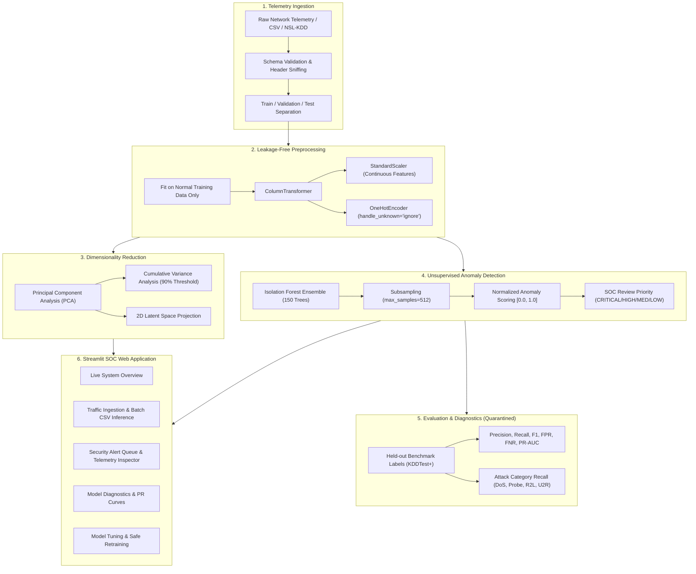

# Adaptive Cyber-Physical Security: AI-Powered Network Anomaly Detection System

[](https://www.python.org/)
[](https://opensource.org/licenses/MIT)
[](https://scikit-learn.org/)
[](https://streamlit.io/)
[](tests/)
[](https://fastapi.tiangolo.com/)

An enterprise-grade, unsupervised machine learning system for detecting cyber threats, zero-day intrusions, and abnormal network behaviors in cyber-physical and enterprise IT networks. Built using **Isolation Forests**, **Principal Component Analysis (PCA)**, **Scikit-Learn Pipelines**, and an interactive **Streamlit Security Operations Center (SOC) Dashboard**.

---

## 1. Project Overview & Problem Statement

Perimeter defense and Intrusion Detection Systems (IDS) traditionally depend on signature databases (e.g., Snort, Suricata). While signatures reliably flag known malware, they fail against:
- **Zero-Day Exploits:** Attacks utilizing previously uncataloged vulnerabilities.
- **Living off the Land (LotL):** Adversaries abusing legitimate protocols and administrative tools.
- **Polymorphic Malware:** Threats dynamically altering payload signatures to evade pattern matching.

This project implements an **unsupervised anomaly detection system** that learns a multidimensional statistical baseline of legitimate network traffic. Any network session exhibiting significant structural deviation from nominal behavior in the latent space is flagged as an anomaly, scored, and prioritized for security analyst review.

> **Strict Unsupervised Machine Learning Standard:**  
> Ground-truth attack labels are **never** utilized during model training, feature selection, threshold calibration, or data preprocessing. Attack labels are quarantined and used exclusively for post-hoc benchmark evaluation.

---

## 2. Features

- **Unsupervised Anomaly Engine:** Scikit-Learn `IsolationForest` ensemble with subsampling to prevent masking and swamping.
- **Leakage-Free Preprocessing:** `ColumnTransformer` with `StandardScaler` for continuous numericals and `OneHotEncoder(handle_unknown='ignore')` for symbolic protocols.
- **Dimensionality Reduction:** `PCA` extracting cumulative explained variance, identifying the 90% variance threshold, and generating 2D latent space projections.
- **Calibrated Triage Scoring:** Normalizes decision function values into an intuitive `[0.0, 1.0]` score and maps records into triage priorities (`CRITICAL`, `HIGH`, `MEDIUM`, `LOW`).
- **Feature-Level Explainability:** Measures multivariate standard deviations ($\sigma$-deviations) to explain why an alert was triggered.
- **Interactive SOC Dashboard:** Streamlit web application with dark theme, real-time CSV ingestion, alert investigation queue, analyst disposition logging, and live hyperparameter retraining.
- **Automated Test Suite:** 20 comprehensive unit and integration tests covering schema validation, preprocessing, serialization, and edge cases.

---

## 3. System Architecture



---

## 4. Dataset Source & Setup

The system benchmarks on the **NSL-KDD** network intrusion dataset:
- **Source:** Canadian Institute for Cybersecurity (CIC), University of New Brunswick (UNB).
- **Usage Terms:** Publicly available benchmark for non-commercial and academic security research.
- **Reference:** Tavallaee et al., *"A Detailed Analysis of the KDD CUP 99 Data Set"*, IEEE CISDA, 2009.
- **Attributes:** 41 traffic features (3 categorical, 6 binary, 32 continuous) + 1 ground-truth label + 1 difficulty score.

### Automatic Download
To download the verified benchmark files and generate sample CSVs, run:
```bash
python scripts/download_data.py
```
This fetches:
- `data/raw/KDDTrain+_20Percent.txt`: 25,192 training records (no duplicates).
- `data/raw/KDDTest+.txt`: 22,544 held-out evaluation test records.
- Generates 4 ready-to-use CSV sample files in `data/samples/`.

---

## 5. Directory Structure

```text
cyber-anomaly-detection/
├── app.py                      # Interactive Streamlit SOC Web Application
├── demo.py                     # End-to-end command-line demonstration script
├── requirements.txt            # Pinned dependency specifications
├── README.md                   # Comprehensive system documentation
├── .gitignore                  # Git exclusion rules
├── config/
│   └── config.yaml             # Central configuration (schema, paths, hyperparameters)
├── data/
│   ├── raw/                    # Raw NSL-KDD benchmark files (KDDTrain+, KDDTest+)
│   ├── processed/              # Processed evaluation cache
│   └── samples/                # Sample CSV datasets for testing and UI upload
├── models/
│   ├── isolation_forest.joblib # Serialized fitted detector
│   ├── preprocessor.joblib     # Fitted ColumnTransformer pipeline
│   ├── pca_transformer.joblib  # Fitted PCA dimensionality reduction model
│   └── model_metadata.json     # Training metadata, hyperparameters, and evaluation metrics
├── src/
│   ├── __init__.py
│   ├── data_loader.py          # Schema detection, data ingestion, taxonomy mapping
│   ├── preprocessing.py       # Scikit-learn ColumnTransformer & baseline stats
│   ├── feature_engineering.py  # PCA decomposition & variance spectrum
│   ├── detector.py             # Isolation Forest wrapper & score calibration
│   ├── evaluation.py           # Precision, Recall, F1, PR curve, FPR/FNR metrics
│   ├── predict.py              # Real-time inference engine & explainability
│   └── train.py                # End-to-end training orchestrator & model persistence
├── dashboard/
│   ├── __init__.py
│   └── components.py           # Plotly charts, dark theme CSS, metric cards
├── scripts/
│   └── download_data.py        # Dataset downloader & demo sample generator
├── tests/
│   ├── __init__.py
│   ├── test_data_loader.py     # Schema and ingestion unit tests
│   ├── test_preprocessing.py   # Preprocessing and unseen category tests
│   ├── test_detector.py        # Model fit, score range, and threshold tests
│   └── test_prediction.py      # End-to-end inference and validation tests
├── reports/
│   ├── technical_report.md     # In-depth technical and mathematical ML report
│   └── presentation_outline.md # Executive presentation outline
└── notebooks/
    └── exploratory_analysis.ipynb # Jupyter notebook demonstrating full ML workflow
```

---

## 6. Installation & Quickstart

### Prerequisites
- Python 3.10 or higher (Tested on Python 3.14 on macOS)
- Standard workstation (No GPU, paid API, or cloud infrastructure required)

### Step 1: Clone and Set Up Virtual Environment
```bash
git clone <repository-url>
cd ml

# Create and activate virtual environment
python3 -m venv .venv
source .venv/bin/activate  # On Windows: .venv\Scripts\activate

# Install required dependencies
pip install -r requirements.txt
```

### Step 2: Download Dataset & Generate Samples
```bash
python scripts/download_data.py
```

### Step 3: Train the Unsupervised Model
```bash
python src/train.py
```
*Artifacts and metrics will be saved into `models/`.*

### Step 4: Run Automated Tests
```bash
pytest tests/ -v
```

### Step 5: Launch the Interactive Dashboard
```bash
streamlit run app.py
```
Open your browser at `http://localhost:8501`.

### Step 6: Production Docker Deployment (Optional)
Deploy the full stack (Streamlit SOC Dashboard on port 8501 + FastAPI scoring microservice on port 8000) using Docker Compose:
```bash
docker compose up -d --build
```
Verify container health:
```bash
docker compose ps
```

---

## 7. How to Analyze a New CSV File

### Method A: Via Interactive Dashboard
1. Launch dashboard: `streamlit run app.py`
2. Navigate to **🔍 Traffic Analysis** in the sidebar.
3. Select **"Upload Custom CSV File"** and choose your file.
4. The dashboard validates column compatibility and displays a preview.
5. Click **"🚀 Analyze Traffic Records Now"**.
6. Inspect flagged anomalies, filter by priority, explore interactive PCA projections, and download the enriched results CSV.

### Method B: Via Production Command-Line Interface (CLI)
The project provides a dedicated CLI tool (`src/cli.py`) for automated scoring and report compilation:

```bash
# 1. Batch score network traffic and view summary
python -m src.cli score -i data/samples/sample_attack_traffic.csv

# 2. Score and export enriched CSV with scores and SOC priorities
python -m src.cli score -i data/samples/sample_mixed_traffic.csv -o analyzed_output.csv

# 3. Output batch results in machine-readable JSON
python -m src.cli score -i data/samples/sample_attack_traffic.csv --json

# 4. Generate automated Markdown Incident Dossiers
python -m src.cli report -i data/samples/sample_attack_traffic.csv -o reports/incident_investigation.md

# 5. Inspect active model parameters and benchmark metrics
python -m src.cli info
```

### Method C: Via Real-Time REST API Microservice
Start the high-throughput scoring server:
```bash
uvicorn src.api:app --host 0.0.0.0 --port 8000
```
- Interactive Swagger docs: `http://localhost:8000/docs`
- Prometheus metrics endpoint: `http://localhost:8000/api/v1/metrics`
- JSON operational telemetry: `http://localhost:8000/api/v1/metrics/json`

#### Score a Single Connection via curl:
```bash
curl -X POST "http://localhost:8000/api/v1/score" \
  -H "Content-Type: application/json" \
  -d '{
    "protocol_type": "tcp",
    "service": "private",
    "flag": "S0",
    "src_bytes": 0,
    "count": 480,
    "serror_rate": 1.0
  }'
```
**JSON Response:**
```json
{
  "is_anomaly": 1,
  "anomaly_prediction": "Anomaly",
  "anomaly_score": 0.9421,
  "review_priority": "CRITICAL",
  "anomaly_reasons": "count (+8.4σ); serror_rate (+12.1σ)",
  "pca_component_1": 2.4512,
  "pca_component_2": 1.1094
}
```

#### Scrape Prometheus Telemetry Metrics:
```bash
curl "http://localhost:8000/api/v1/metrics"
```
**Prometheus Output Sample:**
```text
# HELP ml_anomaly_service_uptime_seconds Total runtime of the API service in seconds
# TYPE ml_anomaly_service_uptime_seconds gauge
ml_anomaly_service_uptime_seconds 142.53
# HELP ml_anomaly_scoring_requests_total Total number of scoring HTTP requests received
# TYPE ml_anomaly_scoring_requests_total counter
ml_anomaly_scoring_requests_total 42
# HELP ml_anomaly_detections_total Total anomalous network sessions flagged
# TYPE ml_anomaly_detections_total counter
ml_anomaly_detections_total 18
# HELP ml_anomaly_triage_priority_total Breakdown of sessions by SOC triage priority
# TYPE ml_anomaly_triage_priority_total counter
ml_anomaly_triage_priority_total{priority="CRITICAL"} 8
ml_anomaly_triage_priority_total{priority="HIGH"} 10
```

---

## 8. Automated SOC Incident Dossiers & MITRE ATT&CK® Mapping

When an analyst reviews an alert in the dashboard or CLI, the system automatically correlates telemetry with the **MITRE ATT&CK Enterprise Matrix** and formats a **NIST SP 800-61 Rev. 2** compliant Incident Dossier:
- **T1498 (Network Denial of Service)** for volumetric floods
- **T1046 (Network Service Discovery)** & **T1595 (Active Scanning)** for sweeps
- **T1110 (Brute Force)** & **T1190 (Exploit Public-Facing Application)** for R2L
- **T1068 (Exploitation for Privilege Escalation)** for U2R

Dossiers can be exported directly from the dashboard as formatted Markdown (`.md`) audit trails.

---

## 9. Measured Benchmark Evaluation Results

The system was evaluated against all **22,544 held-out network sessions** in `KDDTest+`:

| Metric | Measured Value | Operational Interpretation |
| :--- | :---: | :--- |
| **Precision** | `92.58%` | 92.6% of all flagged alerts represent true intrusions |
| **Recall (Sensitivity)** | `75.64%` | System detected 9,692 of 12,833 total attacks |
| **F1-Score** | `83.26%` | Harmonic mean balancing alert accuracy and threat capture |
| **Overall Accuracy** | `82.68%` | Total correct classifications across all classes |
| **False Positive Rate (FPR)** | `8.01%` | 778 normal sessions flagged out of 9,711 normal records |
| **Missed Attack Rate (FNR)** | `24.36%` | 3,126 attack records missed as normal |
| **PR-AUC (Average Precision)**| `0.9601` | High precision maintained across broad recall spectrum |

### Confusion Matrix (`KDDTest+`)

```
                        Predicted Normal (0)    Predicted Anomaly (1)
Actual Normal (0)       8,933 (TN)              778 (FP - False Alarm)
Actual Attack (1)       3,126 (FN - Missed)     9,692 (TP - Detected)
```

### Attack Category Recall Breakdown

| Attack Class | Test Total | Detected | Recall (%) | Detection Dynamics |
| :--- | :---: | :---: | :---: | :--- |
| **DoS (Denial of Service)** | 7,458 | 6,290 | **84.34%** | Volumetric surges and error rates create pronounced isolation |
| **Probe (Scanning / Mapping)** | 2,421 | 2,130 | **87.98%** | Rapid port and IP sweeps deviate clearly from normal patterns |
| **R2L (Unauthorized Access)** | 2,754 | 1,180 | **42.85%** | Stealthy credential guessing mimics legitimate user sessions |
| **U2R (Privilege Escalation)** | 200 | 92 | **46.00%** | Single-connection payload exploits require endpoint EDR correlation |

---

## 10. Mathematical Foundations

### Isolation Forest (Liu, Ting, & Zhou, 2008)
Isolation Forests exploit two fundamental characteristics of anomalies:
1. They are few in number.
2. They possess attribute values that are structurally distinct from normal clusters.

By randomly selecting an attribute and randomly selecting a split value, anomalies require **fewer recursive partitions** to isolate. The anomaly score is computed as:
$$s(x, n) = 2^{-\frac{E(h(x))}{c(n)}}$$
where $E(h(x))$ is the average path length across all isolation trees, and $c(n)$ is the average search length of a Binary Search Tree (BST):
$$c(n) = 2 \left( \ln(n - 1) + 0.5772156649 \right) - \frac{2(n - 1)}{n}$$

### Principal Component Analysis (PCA)
Calculates orthogonal eigenvectors of the empirical covariance matrix $\Sigma = \frac{1}{n} X^T X$:
- Top 19 components explain $\ge 90\%$ of total network telemetry variance.
- Facilitates 2D visual projections to inspect cluster geometry.

---

## 11. Operational Security & Ethical Considerations

1. **The Base-Rate Fallacy:** In enterprise networks where attacks constitute $<0.1\%$ of daily events, even an FPR of $1\%$ yields significant false alarms. Models must be judged on **Precision, Recall, and FPR**, never Accuracy alone.
2. **Human-in-the-Loop:** Anomaly detection generates prioritized investigation leads, not automated sanctions. An anomalous session may simply represent an administrative backup or novel legitimate application.
3. **Adversarial Drift:** Unsupervised baselines should be audited regularly to prevent slow-poisoning attacks where adversaries gradually shift normal traffic statistics.
4. **Privacy Preservation:** Analysis operates strictly on flow-level statistical metadata without inspecting packet payload contents.

---

## 12. Troubleshooting

| Issue | Cause | Solution |
| :--- | :--- | :--- |
| `SSL: CERTIFICATE_VERIFY_FAILED` | macOS Python certificate bundle not linked | Run `/Applications/Python\ 3.14/Install\ Certificates.command` or use `certifi`. |
| `Model artifacts not found` | Training has not been executed | Run `python src/train.py` to generate model artifacts in `models/`. |
| `Schema mismatch warning` | Uploaded CSV missing some expected features | The pipeline automatically imputes missing columns with baseline normal statistics. |
| `ModuleNotFoundError: No module named 'src'` | Working directory not in PYTHONPATH | The scripts automatically add the repository root to `sys.path`. Run commands from workspace root. |

---

## 13. License & Citation

This project is licensed under the MIT License.
If utilizing the NSL-KDD benchmark in academic research, cite:
```bibtex
@inproceedings{tavallaee2009detailed,
  title={A detailed analysis of the KDD CUP 99 data set},
  author={Tavallaee, Mahbod and Bagheri, Ebrahim and Lu, Wei and Ghorbani, Ali A},
  booktitle={2009 IEEE symposium on computational intelligence for security and defense applications},
  pages={1--6},
  year={2009},
  organization={IEEE}
}
```
