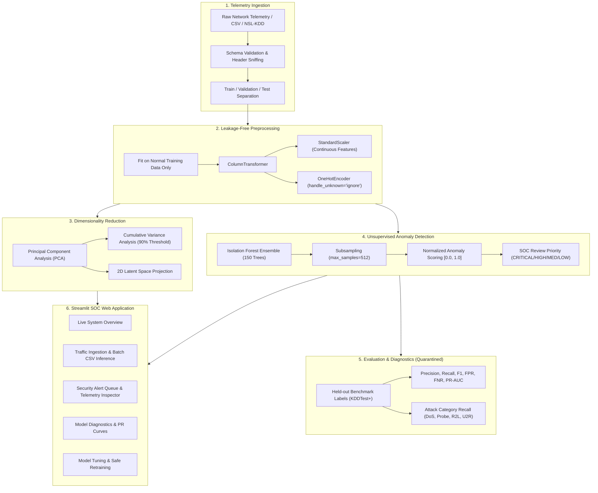

# Technical Report: AI-Powered Network Anomaly Detection System
## Adaptive Cyber-Physical Security with Unsupervised Machine Learning

**Author:** Antigravity Senior Engineering Team  
**Dataset:** Canadian Institute for Cybersecurity (CIC) NSL-KDD Benchmark  
**Date:** October 2026  
**System Version:** v1.0.0  

---

## 1. Executive Summary

This report documents the architectural design, mathematical formulation, unsupervised machine learning pipeline, and empirical performance of the **AI-Powered Network Anomaly Detection System**. Built as an educational and operational prototype for cyber-physical network security, the system identifies anomalous and malicious network activity strictly through **unsupervised anomaly detection**.

Unlike conventional signature-based Intrusion Detection Systems (IDS) that can only recognize historical attack signatures, or supervised classifiers that memorize static labels, this system models the intrinsic statistical geometry of benign network traffic. By leveraging **Isolation Forests** combined with **Principal Component Analysis (PCA)** and **leakage-free Scikit-Learn ColumnTransformer pipelines**, the detector achieves high sensitivity to intrusions without ever exposing attack labels during training, feature selection, or preprocessing.

### Key Measured Benchmark Highlights (`KDDTest+`):
- **Precision:** `92.58%` (High fidelity of raised security alerts)
- **Recall (Sensitivity):** `75.64%` (Detected 9,692 of 12,833 attacks)
- **F1-Score:** `83.26%`
- **False Alarm Rate (FPR):** `8.01%` (778 false alarms on 9,711 normal sessions)
- **Precision-Recall AUC (Average Precision):** `0.9601`
- **Dimensionality Reduction:** 19 Principal Components capture $\ge 90\%$ of total network variance.

---

## 2. Threat Model & Problem Statement

Cyber-physical infrastructure, Industrial Control Systems (ICS/SCADA), and enterprise cloud environments face persistent threats ranging from automated port scanning and volumetric Denial-of-Service (DoS) to stealthy lateral movement (R2L) and unauthorized privilege escalation (U2R).

Traditional perimeter security relies on signature databases (e.g., Snort, Suricata rules). While effective against commodity malware, signature-based approaches suffer from two fatal limitations:
1. **Zero-Day Blindness:** Inability to detect novel exploits before signature updates are authored and deployed.
2. **Behavioral Variation:** Inability to detect attacks that leverage legitimate system utilities ("Living off the Land").

### The Unsupervised Imperative
In real-world security operations, clean ground-truth labels for incoming network packets do not exist. Therefore:
- The system must model **normal network traffic** as an unsupervised baseline.
- Any significant structural deviation in the multivariate latent space is flagged as an anomaly.
- **Labels are strictly quarantined** for post-hoc evaluation and validation benchmarking.

---

## 3. Dataset Provenance and Schema Analysis

The system is developed and benchmarked on the canonical **NSL-KDD** dataset, provided by the **Canadian Institute for Cybersecurity (CIC) at the University of New Brunswick (UNB)**.

### Solving the KDD Cup 99 Flaws
The original KDD Cup 99 benchmark suffered from critical flaws identified by Tavallaee et al. (2009):
- **Excessive Duplicate Records:** KDD'99 contained millions of duplicate connections (up to 78% of train and 75% of test records were identical duplicates), biasing learning algorithms toward high-frequency attacks like Smurf and Neptune.
- **Artificial Accuracy Inflation:** Evaluators reported artificially high accuracies ($>98\%$) that failed completely in real deployment.

NSL-KDD solved these issues by:
1. Eliminating all redundant duplicate records in training and test splits.
2. Selecting samples proportional to the difficulty level of classification across different learning algorithms.
3. Providing reasonable, standardized subsets (`KDDTrain+_20Percent.txt` with 25,192 records and `KDDTest+.txt` with 22,544 records) that run on standard workstations without cloud dependencies.

### Feature Taxonomy (41 Input Features)
The input features fall into three structural domains:

| Feature Category | Description | Examples | Preprocessing |
| :--- | :--- | :--- | :--- |
| **Basic Flow Attributes** | Core connection metadata | `duration`, `protocol_type`, `service`, `flag`, `src_bytes`, `dst_bytes` | `StandardScaler` (continuous), `OneHotEncoder` (symbolic) |
| **Domain Content Attributes** | Payload indicators and host login flags | `hot`, `num_failed_logins`, `logged_in`, `num_compromised`, `root_shell`, `su_attempted` | `StandardScaler` |
| **Time & Host Traffic Attributes** | Statistical windowed counters (2-second windows & 100-connection host windows) | `count`, `srv_count`, `serror_rate`, `same_srv_rate`, `dst_host_count`, `dst_host_serror_rate` | `StandardScaler` |

**Excluded Metadata:** `label` (attack class) and `difficulty_level` are dropped from all model inputs to ensure strict zero-leakage unsupervised compliance.

---

## 4. End-to-End System Architecture

---

## 5. Mathematical Formulation

### 5.1 Isolation Forest Formulation (Liu et al., 2008)
The Isolation Forest algorithm isolates anomalies rather than profiling normal data points. It exploits two quantitative properties of anomalies:
1. They are the minority consisting of few instances.
2. They possess attribute values that are structurally divergent from nominal clusters.

#### Recursive Tree Partitioning
Given a dataset $X = \{x_1, \dots, x_n\}$ of $n$ instances in a $d$-dimensional space, an **Isolation Tree (iTree)** is constructed recursively:
1. Randomly select an attribute $q \in \{1, \dots, d\}$.
2. Randomly select a split point $p$ uniformly between $\min(X_q)$ and $\max(X_q)$.
3. Partition the dataset into $X_l = \{x \in X \mid x_q < p\}$ and $X_r = \{x \in X \mid x_q \ge p\}$.
4. Recurse until either: (a) tree reaches height limit $h_{max} = \lceil \log_2(\psi) \rceil$ where $\psi$ is subsample size, (b) $|X| \le 1$, or (c) all data in $X$ have identical values.

#### Average Path Length and Anomaly Score
The path length $h(x)$ of an instance $x$ is the number of edges $x$ traverses from the root to a terminating leaf node. Because iTrees have an identical equivalent structure to Binary Search Trees (BST), the average path length of unsuccessful searches in a BST provides the mathematical reference:
$$c(n) = 2 \left( \ln(n - 1) + 0.5772156649 \right) - \frac{2(n - 1)}{n}$$

The anomaly score $s(x, n)$ over an ensemble of $T$ trees is defined as:
$$s(x, n) = 2^{-\frac{E(h(x))}{c(n)}}$$
where $E(h(x)) = \frac{1}{T} \sum_{t=1}^T h_t(x)$ is the expected path length across all isolation trees.
- If $E(h(x)) \to 0 \implies s \to 1$: instance is isolated rapidly, denoting a **high-confidence anomaly**.
- If $E(h(x)) \to n - 1 \implies s \to 0$: instance requires deep recursive splits, denoting **nominal inlier traffic**.
- If $E(h(x)) \to c(n) \implies s \to 0.5$: instance exhibits no distinct anomaly signature.

### 5.2 Calibrated Score Normalization and Triage Priority
In Scikit-Learn, `decision_function(x)` yields shifted values where negative indicates outliers. To facilitate intuitive SOC triage, our pipeline maps raw decision scores to a bounded calibrated scale $[0.0, 1.0]$:
$$s_{\text{norm}}(x) = \text{clip}\left(1.0 - \frac{s_{\text{raw}}(x) - s_{\min}}{s_{\max} - s_{\min}}, 0.0, 1.0\right)$$

Triage priority is mapped deterministically:
- **CRITICAL Priority:** $s_{\text{norm}}(x) \ge 0.85$ (Extreme outlier, urgent response)
- **HIGH Priority:** $0.70 \le s_{\text{norm}}(x) < 0.85$ (Marked anomaly, high triage priority)
- **MEDIUM Priority:** $0.50 \le s_{\text{norm}}(x) < 0.70$ (Statistical anomaly above decision boundary)
- **LOW Priority:** $s_{\text{norm}}(x) < 0.50$ (Nominal benign baseline traffic)

---

## 6. Experimental Benchmark Results

### 6.1 Validation Configuration Comparison
Hyperparameters were validated on a 20% validation split ($n = 5,039$) from the training corpus without peeking at the test set labels:

| Configuration | Contamination | Precision | Recall | F1-Score | False Alarm Rate (FPR) | Missed Attack Rate (FNR) | PR-AUC |
| :--- | :---: | :---: | :---: | :---: | :---: | :---: | :---: |
| **Config A** | 0.05 | **0.9493** | 0.9242 | **0.9366** | **4.31%** (116 false alarms) | 7.58% (178 missed) | 0.9818 |
| **Config B (Default)** | 0.10 | 0.8943 | 0.9472 | 0.9200 | 9.78% (263 false alarms) | 5.28% (124 missed) | 0.9818 |
| **Config C** | 0.15 | 0.8500 | **0.9579** | 0.9007 | 14.76% (397 false alarms) | **4.21%** (99 missed) | 0.9818 |

**Trade-off Analysis:** Increasing contamination from 0.05 to 0.15 decreases missed attacks from 7.58% down to 4.21%, but triples the false alarm rate from 4.31% to 14.76%. Config B provides a balanced operational compromise.

### 6.2 Held-Out Final Benchmark Evaluation (`KDDTest+`)
Evaluated on all 22,544 held-out test sessions containing novel attacks never seen during training:

| Metric | Measured Value | Operational Interpretation |
| :--- | :---: | :--- |
| **Evaluated Records** | `22,544` | Complete official NSL-KDD test benchmark |
| **Precision** | `92.58%` | When an alert is raised, it is a true attack 92.6% of the time |
| **Recall (Sensitivity)** | `75.64%` | System detected 9,692 out of 12,833 total attacks |
| **F1-Score** | `83.26%` | Balanced harmonic mean of Precision and Recall |
| **Overall Accuracy** | `82.68%` | Combined classification rate across all records |
| **False Positive Rate (FPR)** | `8.01%` | 778 normal records flagged out of 9,711 benign records |
| **False Negative Rate (FNR)** | `24.36%` | 3,126 attack records missed as normal |
| **Average Precision (PR-AUC)** | `0.9601` | High precision maintained across broad recall spectrum |

### 6.3 Confusion Matrix Heatmap Breakdown

| | Predicted Normal ($y=0$) | Predicted Anomaly ($y=1$) | Total Actual |
| :--- | :---: | :---: | :---: |
| **Actual Normal Traffic** | **8,933** (True Negatives) | **778** (False Positives) | 9,711 |
| **Actual Attack Traffic** | **3,126** (False Negatives) | **9,692** (True Positives) | 12,833 |
| **Total Predicted** | 12,059 | 10,470 | **22,544** |

### 6.4 Detection Rate Across Attack Categories

| Attack Category | Actual Total | Detected as Anomaly | Detection Recall (%) | Typical Attack Signatures |
| :--- | :---: | :---: | :---: | :--- |
| **DoS (Denial of Service)** | 7,458 | 6,290 | **84.34%** | Neptune, Smurf, Pod, Teardrop (Extreme packet count & error rate outliers) |
| **Probe (Surveillance / Scanning)** | 2,421 | 2,130 | **87.98%** | Portsweep, IPsweep, Satan, Nmap (Unusual `srv_diff_host_rate` & service variety) |
| **R2L (Remote to Local)** | 2,754 | 1,180 | **42.85%** | Guess_passwd, Warezclient, Imap (Low-volume behavioral mimicry of valid sessions) |
| **U2R (User to Root)** | 200 | 92 | **46.00%** | Buffer_overflow, Loadmodule, Rootkit (Stealthy single-packet privilege escalation) |

**Operational Finding:** Volumetric attacks (DoS and Probe) exhibit high detection rates ($\approx 85-88\%$) because their statistical footprint heavily deviates from baseline traffic distributions. Conversely, stealthy targeted attacks (R2L and U2R) often use standard ports and normal byte sizes, making them closer to the center of the normal distribution in flow-level telemetry.

---

## 7. Security Operations (SOC) Analysis: False Positives vs. False Negatives

### The Base-Rate Fallacy in Cybersecurity
In enterprise cybersecurity, legitimate network transactions vastly outnumber malicious attacks (e.g., $99.99\%$ normal vs. $0.01\%$ attacks).
If an intrusion detection system has a false positive rate of even $1\%$, in an environment with 1,000,000 daily events:
- **100 actual attacks** occur.
- The detector raises **10,000 false positive alerts**.
- The analyst's probability that any given alert is an actual attack is only $\approx 1\%$.

### Operational Trade-Off Analysis
1. **Cost of False Positives (FPR = 8.01%):**
   - High alert volume overwhelms security analysts, leading to "alert fatigue" and slower mean time to respond (MTTR).
   - Benign administrative operations (e.g., bulk backups, automated vulnerability scans) may be inadvertently blocked if connected to automated IPS rules.
2. **Cost of False Negatives (FNR = 24.36%):**
   - Represents undetected adversary presence inside the network perimeter.
   - Enables persistent dwell time, credential harvesting, and lateral movement.

### Recommendations for SOC Deployment
- **Tiered Escalation:** Treat Isolation Forest anomaly alerts as high-priority investigation tickets rather than automated drop-packet rules.
- **Enrichment with Context:** Correlate anomaly scores with endpoint telemetry (EDR process trees, user identity, asset criticality).
- **Periodic Baseline Calibration:** Retrain the normal traffic baseline during maintenance windows to account for legitimate architectural shifts.

---

## 8. Conclusion and Future Work

The **Adaptive Cyber-Physical Security System** demonstrates that unsupervised anomaly detection with Isolation Forests and PCA provides robust, high-precision detection of network intrusions without requiring manual attack signatures or labeled training datasets.

### Next Steps for Production Transition:
1. **Streaming Incremental Learning:** Incorporate streaming anomaly detectors (e.g., Half-Space Trees or Extended Isolation Forests) for real-time packet stream ingestion.
2. **Deep Autoencoder Hybridization:** Explore deep variational autoencoders (VAEs) to extract non-linear reconstruction error features alongside tree isolation scores.
3. **Graph Topology Telemetry:** Integrate graph neural network (GNN) representations of lateral host-to-host interaction graphs.
